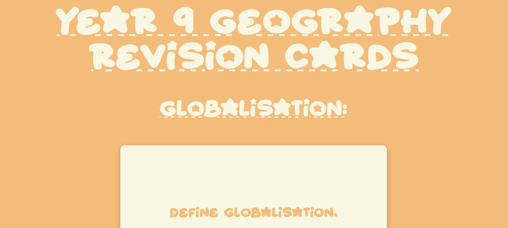

# Revision web
A basic HTML and CSS website (with one line of JS) for revision cards about important facts that you learn in year 9.

[Click here to take a look at the files!] --> (https://pinklady1209.github.io/revision-web/)

[Click here to try it out!] --> (https://revision-web-pearl.vercel.app/)

## Features
- On click flip cards
- History, geography and computing facts
- Warm tone colours
- Clear titles

## Running on your own

Download the project files and open up 'index.html'!